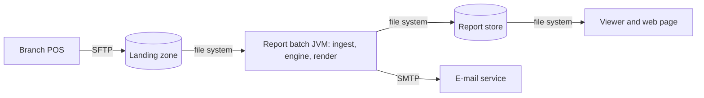
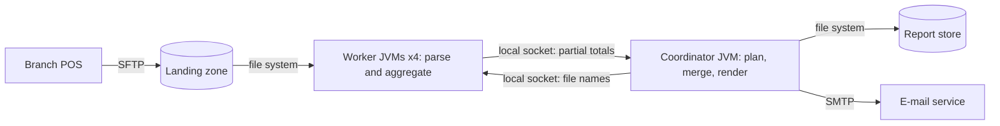
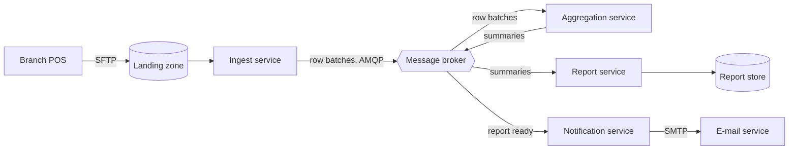

# ATAM-style evaluation: release 1 architecture

Question from head office: does ADR-0001 still hold if the chain opens more
branches and wants the report earlier? Scenarios QA-1..QA-6 are those of
`quality-scenarios.md` (drivers: QA-1, QA-3, QA-5).

## Business drivers
- BD-1: report for month M on the morning of day 2 of M+1 (brief); "earlier" is the new wish.
- BD-2: branch links fail now and then, yet the report must come out on time (QA-3).
- BD-3: branch managers see their own branch only (QA-5).
- BD-4: the chain is expected to grow beyond 3 branches (QA-2); a team of 2 builds and runs it.

## Candidates
### A: modular monolith batch (one JVM)

### B: process pipeline

### C: event-driven microservices

## Scenario analysis
Ratings: ++ very good, + good, 0 neutral, - weak.

| Scenario | A monolith batch | B process pipeline | C microservices |
|----------|------------------|--------------------|-----------------|
| QA-1 3 M rows in 60 s or less | ++ about 4.9 s, in-process calls, no copying | + about 7.3 s, JVM start-up and socket hop | 0 about 5.7 s only with 1 000 rows per event; 63 s at 1 row per event |
| QA-2 4th branch adds at most 35 % run time | + 4 branches = 4/3 of the rows, so about +33 % (6.5 s); vertical scaling only | + add workers or machines, about +10 % | ++ add consumers; the broker is the limit |
| QA-3 late REP file: others out by 07:00 | + per-branch processing plus ADR-0002 policy; one JVM is a single point of failure but re-runs are idempotent | + a crashed worker is restarted alone; the coordinator is still a single point | ++ broker buffers late files, branches are independent; the broker itself must be clustered |
| QA-4 new export format in 2 days or less | + sealed Strategy: 1 class, 1 permit, 1 case | + same code, plus a worker protocol that does not change | 0 new or changed service, contract version and deployment |
| QA-5 manager sees own branch only | ++ no network between components; one access check at the viewer | + local sockets only, small surface | - broker and service-to-service authentication, topic ACLs per branch |
| QA-6 engine tests in 30 s or less | ++ plain JUnit, seconds | 0 needs process-level integration tests | - needs broker or containers and contract tests |
| Cost and skills (2 people, 8 weeks) | ++ Java and Maven only, one thing to run | 0 process management and a wire format to learn | - broker, deployment and monitoring to learn and operate |

## QA-1 estimates (assumptions first)
Assumptions: 3.0 M rows; parsing and validating 5 microseconds per row on one
core, so 15 s of CPU; aggregation merge 2 s and rendering 1 s are serial (3 s);
8 cores; files already on local disk. B: 4 worker JVMs, one parsing thread
each, 0.5 s JVM start-up in parallel, partial totals are a few KB (negligible
IPC). C: broker 50 000 messages per second; serialization plus
deserialization 2 microseconds per row (6 s of CPU, parallel); services
already running.

Amdahl's law, with T1 = 15 + 3 = 18 s on one core, parallel fraction
p = 15 / 18 = 0.83 and N parallel units:
speedup S(N) = 1 / ((1 - p) + p / N), so T(N) = T1 / S(N) = (1 - p) x T1 + p x T1 / N.

| Candidate | Arithmetic | Result | QA-1 (60 s) |
|-----------|------------|--------|-------------|
| A, 8 threads | 15 / 8 + 2 + 1 = 1.875 + 3. By Amdahl: S(8) = 1 / (0.167 + 0.833 / 8) = 3.69, T = 18 / 3.69 | 4.9 s | meets |
| B, N = 4 | 0.5 + 15 / 4 + 2 + 1 = 0.5 + 3.75 + 3. S(4) = 18 / 6.75 = 2.67 without start-up | 7.3 s | meets |
| C, 1 row per event | 3.0 M / 50 000 = 60 s of broker time alone, plus 3 s serial work after the last message | about 63 s | fails |
| C, 1 000 rows per event | 3 000 / 50 000 = 0.06 s broker; 15 / 8 + 6 / 8 + 0.06 + 3 = 1.875 + 0.75 + 0.06 + 3 | 5.7 s | meets |

Upper bound of Amdahl for A: S(infinity) = 18 / 3 = 6, so T cannot fall below
3 s however many cores we add. Growth check for A with 10 branches (10 M
rows, serial part grows with rows too): 50 / 8 + 3 x 10 / 3 = 6.25 + 10 = 16.3 s,
still within 60 s.

"Earlier": compute time is about 5 s, so the limit on when the report can
exist is the arrival of the last daily file (23:00 on the last day of M), not
the architecture. Moving the scheduler from 06:00 to about 23:30 on that day
needs no change in A, B or C.

## Sensitivity points
- S1: parse cost per row (5 to 10 microseconds) affects QA-1 in A, B and C: A
  goes 4.9 s to 6.8 s (30 / 8 + 3), B 7.3 s to 11 s; still far from 60 s.
- S2: serial share (merge plus render, now 3 s) affects QA-1 and QA-2 in A and
  B: doubling the cores from 8 to 16 saves only 15 / 8 - 15 / 16 = 0.94 s, while
  halving the serial work saves 1.5 s; the serial part is the floor (Amdahl).
- S3: event batch size in C affects QA-1 by three orders of magnitude (60 s
  against 0.06 s of broker time).
- S4: the wait before publishing a partial report (06:30 in ADR-0002) affects
  QA-3 in all candidates: the 07:00 target leaves about 25 min of slack for
  a late file; a longer wait risks missing the target, a shorter one publishes
  partial reports more often.

## Trade-off points
- T1: a broker between ingest and aggregation (C) buffers late files and
  decouples branches (+QA-3, +QA-2) but adds a network hop, serialization and
  an operated component (-QA-1, -cost, -QA-5 attack surface).
- T2: process isolation (B) contains a crashing worker (+QA-3) and spreads
  work over machines (+QA-2), but costs about 2.4 s more than A (-QA-1) and
  needs process-level tests (-QA-6).
- T3: keeping the whole month in memory (what `MonthLoader.load` returns in
  Lab-01) keeps the engine simple (+QA-4, +QA-6) but memory grows with
  the rows (-QA-2).

## Risks, non-risks, risk themes
Risks
- R1 (A, B): memory. Assuming about 500 bytes per parsed row (5 strings, 2
  BigDecimals, a record), 3 M rows are about 1.5 GB and 10 M rows about
  5 GB held at once; the heap may become the limit before the CPU does.
- R2 (A, B): a late or lost branch file leaves the chain total incomplete at
  06:30; the finance director could act on a partial figure.
- R3 (C): the broker is a new single point of failure that a team of two
  cannot operate with confidence (upgrades, clustering, monitoring).

Non-risks
- NR1: QA-1 in A has a 12x margin (4.9 s against 60 s); even at 4x the parse
  cost (20 microseconds per row) it is 60 / 8 + 3 = 10.5 s.
- NR2: parallel aggregation does not change money totals: BigDecimal addition
  is exact and associative, so merge order does not matter (it would with
  double).
- NR3: adding PDF or XLSX (QA-4) is about 3 touched places in the sealed
  Strategy hierarchy in every candidate.

Risk themes
- RT1 "The morning report must be complete and on time" (R2, R3), linked to
  BD-1 and BD-2: late data and operational fragility threaten the one thing
  head office cares about.
- RT2 "Growth beyond one JVM" (R1), linked to BD-4: more branches and rows
  first hit the heap, then the serial floor.

## Recommendation
Confirm ADR-0001: keep the modular monolith batch (A). It wins or ties on
QA-1, QA-4, QA-5, QA-6 and cost; C wins only QA-2 and QA-3, and QA-3 is
already covered for A by the file-based failure policy of ADR-0002 (06:30
cutoff, labelled partial report, idempotent re-run). No ADR-0003 is needed.
Two follow-ups mitigate the risks: process the month file by file (streaming
aggregation) in Lab-02 to answer R1, and keep the revisit triggers of ADR-0001
(more than 10 M rows per month, QA-1 median above 30 s, more than 6
branches). If a trigger fires, move to B (worker JVMs) before considering C.
