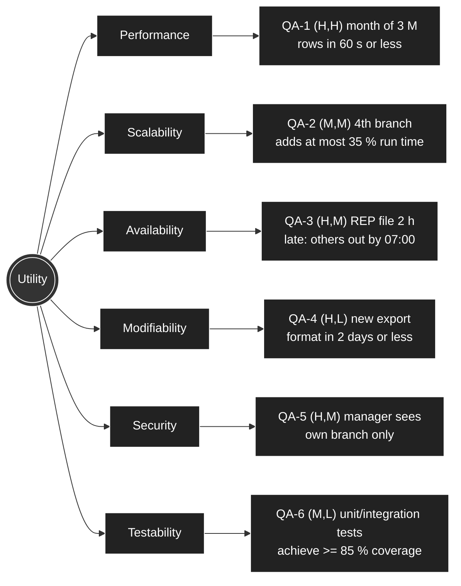

# Quality-attribute scenarios: Angkor Mart monthly sales report

## Stakeholders

- Head-office analyst: Person 1
- Branch manager (PNH, REP, BTB): Person 2 , Person 3 , Person 4

## Scenarios

| ID   | Attribute     | Source                           | Stimulus                                                                       | Artifact                                  | Environment                                     | Response                                                                 | Response measure                                                                       | Rank  |
| ---- | ------------- | -------------------------------- | ------------------------------------------------------------------------------ | ----------------------------------------- | ----------------------------------------------- | ------------------------------------------------------------------------ | -------------------------------------------------------------------------------------- | ----- |
| QA-1 | Performance   | Scheduler, 06:00 on day 2 of M+1 | Starts the report for a month of about 3 M rows                                | Report engine                             | Normal operation, 8-core server, files complete | Report files written, "ready" event published                            | <= 60 s wall-clock, median of 5 runs after 2 warm-up runs                              | (H,H) |
| QA-2 | Scalability   | Batch Job Runner                 | Data volume increases 5x (from 3M to 15M rows) during year-end audit           | Ingestion & Aggregation Engine            | Peak annual volume                              | System completes full batch processing without OutOfMemory errors        | Completes in **< 10 minutes** using **<= 2x** additional heap memory                   |
| QA-3 | Availability  | Branch Internet Link             | Internet connection fails at Siem Reap (REP) branch during 23:00 file transfer | Data Ingestion Gateway                    | WAN failure / Degradation                       | System buffers data locally, detects link recovery, and resumes transfer | **0% data loss**; automatic sync completes within **< 30 seconds** of link restoration |
| QA-4 | Modifiability | Development Team                 | Request to add a new tax breakdown field to the report schema                  | CSV Parser & Report Renderer              | Maintenance mode                                | Developer updates schema, parser, and PDF generator                      | Requires **<= 2.0 person-days** of effort and **<= 150 lines** of code changed         |
| QA-5 | Security      | Branch Manager                   | Branch manager attempts to access sales data belonging to another branch       | Web UI & Authorization Service            | Normal operation                                | System enforces branch isolation, blocks access, and logs audit alert    | **100% of unauthorized requests blocked**; audit log written in **< 1 second**         |
| QA-6 | Testability   | QA Tester                        | Executes automated unit and integration test suite on transaction parser       | Core Parsing Engine (`TransactionParser`) | CI/CD Pipeline                                  | Test suite runs against valid and invalid CSV samples                    | Test suite achieves **>= 85% code coverage** and executes in **< 30 seconds**          |

## Rank justifications

- QA-1 (H,H): the report is due in the morning; 3 M rows with BigDecimal ...

| ID       | Quality Attribute | Source               | Stimulus                                                                       | Artifact                                  | Environment                       | Response                                                                 | Response Measure                                                                       |
| :------- | :---------------- | :------------------- | :----------------------------------------------------------------------------- | :---------------------------------------- | :-------------------------------- | :----------------------------------------------------------------------- | :------------------------------------------------------------------------------------- |
| **QA-1** | Performance       | Head-Office Analyst  | Requests monthly consolidated chain report                                     | Reporting Engine                          | Normal operation, ~3,000,000 rows | System processes monthly CSV data and outputs PDF/Excel                  | Execution time is **< 120 seconds**, measured over 5 runs after 2 warm-up runs         |
| **QA-2** | Scalability       | Batch Job Runner     | Data volume increases 5x (from 3M to 15M rows) during year-end audit           | Ingestion & Aggregation Engine            | Peak annual volume                | System completes full batch processing without OutOfMemory errors        | Completes in **< 10 minutes** using **<= 2x** additional heap memory                   |
| **QA-3** | Availability      | Branch Internet Link | Internet connection fails at Siem Reap (REP) branch during 23:00 file transfer | Data Ingestion Gateway                    | WAN failure / Degradation         | System buffers data locally, detects link recovery, and resumes transfer | **0% data loss**; automatic sync completes within **< 30 seconds** of link restoration |
| **QA-4** | Modifiability     | Development Team     | Request to add a new tax breakdown field to the report schema                  | CSV Parser & Report Renderer              | Maintenance mode                  | Developer updates schema, parser, and PDF generator                      | Requires **<= 2.0 person-days** of effort and **<= 150 lines** of code changed         |
| **QA-5** | Security          | Branch Manager       | Branch manager attempts to access sales data belonging to another branch       | Web UI & Authorization Service            | Normal operation                  | System enforces branch isolation, blocks access, and logs audit alert    | **100% of unauthorized requests blocked**; audit log written in **< 1 second**         |
| **QA-6** | Testability       | QA Tester            | Executes automated unit and integration test suite on transaction parser       | Core Parsing Engine (`TransactionParser`) | CI/CD Pipeline                    | Test suite runs against valid and invalid CSV samples                    | Test suite achieves **>= 85% code coverage** and executes in **< 30 seconds**          |

## Assumptions

- A1: the report server has 8 cores and an SSD (to confirm with the client).

1. **QA-1 Volume:** Peak dataset volume per month across all 3 branches (PNH, REP, BTB) is approximately 3,000,000 rows (33,000 rows/branch/day × 30 days × 3 branches).
2. **QA-3 Network:** Branch POS units maintain local disk buffering for generated daily CSV files during WAN link dropouts.
3. **QA-5 Authorization:** Role-based access control (RBAC) restricts branch manager accounts strictly to queries containing their assigned branch ID.

## Utility tree

## Architectural drivers

The primary architectural drivers driving system design decisions are:

- **QA-1 (Performance): Rank (H, H)**
- **QA-3 (Availability): Rank (H, M)**
- **QA-5 (Security): Rank (H, M)**
